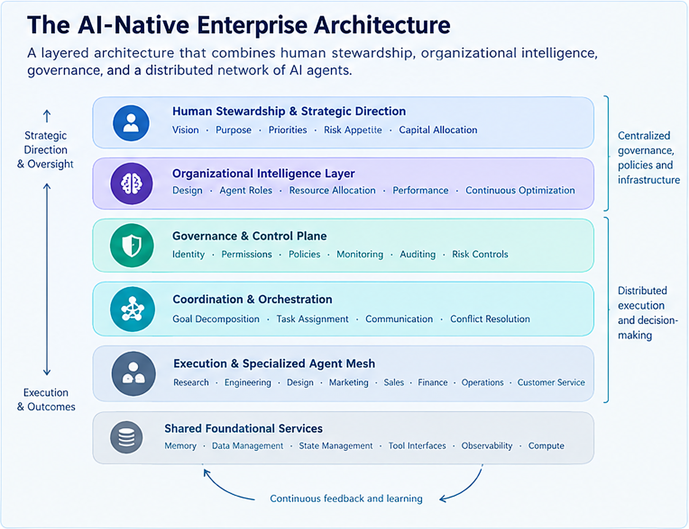
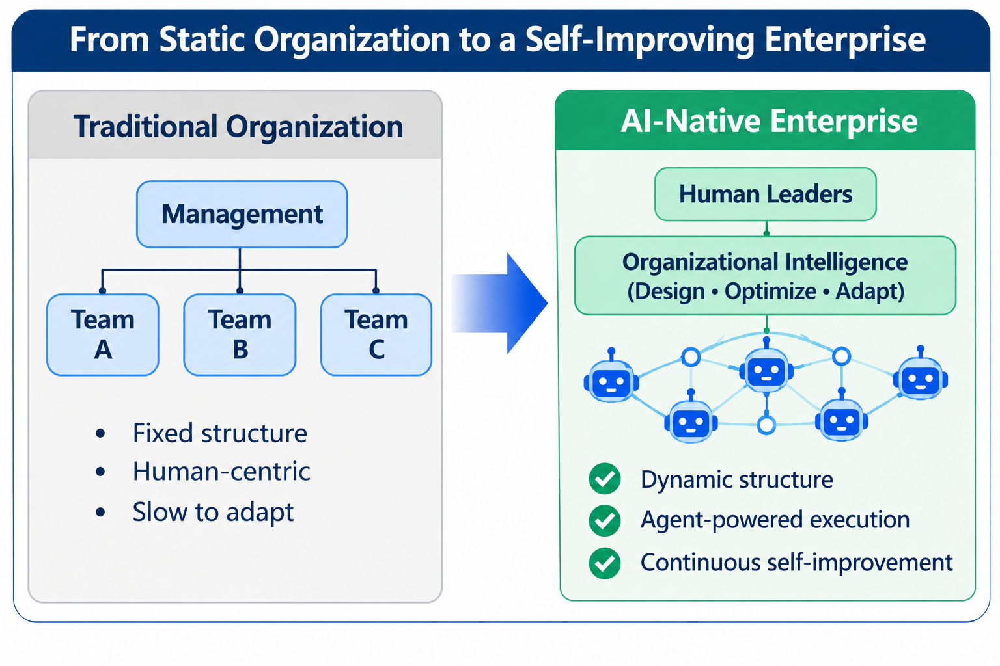
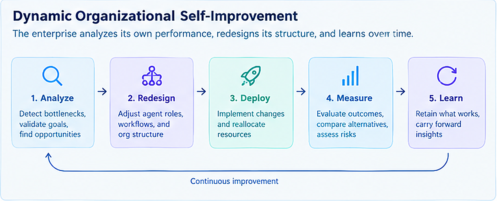
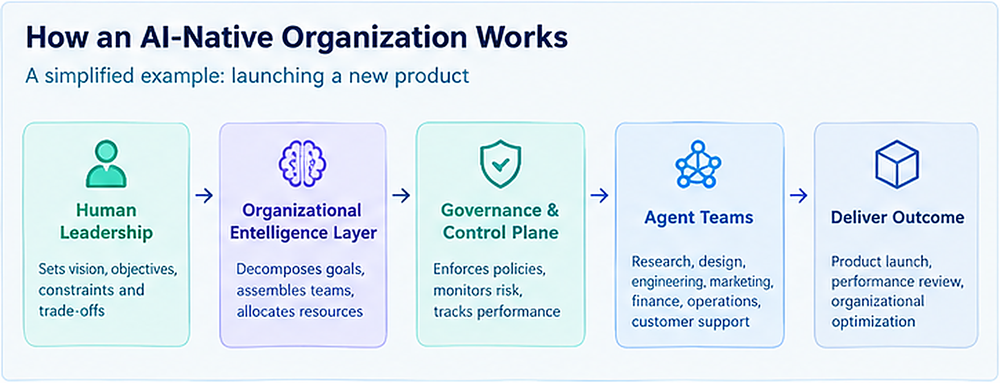

**AI agents may transform organizational architecture, the economics of scale, and the future of human leadership.**

The enterprise is becoming an intelligent, programmable, and self-improving system.

Traditional companies are designed around the capabilities and limitations of human workers. AI-native enterprises will increasingly be designed around the capabilities of intelligent agents.

In this new paradigm, organizational architecture becomes a software engineering discipline. Human leadership shifts from managing people and supervising execution toward defining purpose, establishing constraints, allocating resources, and stewarding an increasingly autonomous organization.

The competitive advantage may no longer come primarily from having the most talented workforce, but from designing the most capable organizational system.

 <!--more-->

## The Enterprise Is Becoming Software

A major impact of AI may be the reinvention of organizations and enterprise software architecture. Rather than the automation of particular jobs from a human skill replication perspective, such as with software engineers, analysts, consultants, and other knowledge workers; what if the most consequential impact of AI is not simply that machines will perform tasks previously done by humans, but that the underlying structures through which humans organize intellectual work will fundamentally change?

Consider the new breed of AI-native organizations where few human stewards direct a large network of specialized AI agents for execution, designed around agentic AI capabilities rather than human organizational limitations, operating with higher parallelism, reduced coordination costs, persistent institutional memory, rapid experimentation, and dynamic resource allocation. This type of organization has a greater potential for higher economies of scale than traditional enterprises.

Consequently, this evolution can upend traditional software engineering practices and organizational structures, as increasingly we could be designing and building software architectures that meet the needs of AI agents (managed by human stewardship) as opposed to traditional enterprise IT environments. And that leads to the question: what will organizations look like when most of their intellectual and operational work is performed by AI rather than humans?

We may be approaching the emergence of an entirely new organizational paradigm: the AI-native enterprise, built with a new software paradigm.

## From Automating Tasks to Redesigning Work

### The Changing Nature of Software Engineering

As AI becomes increasingly proficient at understanding requirements, generating code, debugging implementations, and even reverse-engineering complex systems, the role of software engineers is shifting toward higher-level activities:
- Identifying problems worth solving.
- Defining requirements and desired outcomes.
- Designing system architectures.
- Establishing constraints and trade-offs.
- Evaluating reliability, security, and performance.
- Verifying that the resulting software accomplishes its intended purpose.

Software engineers are not becoming obsolete, but the nature of our contributions is changing, as the code generation part of our traditional roles is getting automated and commoditized. There is also a distinction between software written primarily for human consumption and software produced and maintained primarily by AI.

Historically, software engineering practices have placed considerable emphasis on human readability, maintainability, and communication between developers. In an environment where AI agents are the primary authors and maintainers of software, some of these conventions may evolve toward machine-verifiable specifications, explicit constraints, traceable decisions, automated testing, and formal guarantees, rather than relying as heavily on code readability as the primary mechanism for maintainability.

Human oversight will remain important, particularly for critical systems, but the traditional relationship between humans and source code may change substantially. Ultimately, software engineering will become less about writing code and more about systems engineering.

### The Shifting Value of Human Intellectual Work

The implications extend well beyond software engineering. As AI becomes capable of performing increasingly sophisticated intellectual tasks, one impact is the relative value of traditional knowledge and execution skills. This is not unprecedented. Machines reduced the economic importance of physical strength. Computers reduced the need for manual calculations. Search engines reduced the value of memorizing information. Generative AI is now reducing the cost of producing certain kinds of intellectual output.

When a capability becomes abundant, its economic value tends to diminish. The scarce resource shifts elsewhere.

If everyone can use AI to write competent software, generate presentations, conduct research, or produce marketing materials, the ability to execute these tasks becomes less differentiating. What becomes more valuable is the ability to determine what should be created, why it matters, and what constitutes an exceptional result. This points toward several potentially important human capabilities:
- **Creativity and imagination**: Envisioning possibilities and opportunities that do not yet exist.
- **Judgment**: Evaluating competing objectives and making decisions under uncertainty.
- **Taste**: Recognizing quality, elegance, and significance beyond what can easily be measured.
- **Empathy**: Understanding human needs, motivations, and emotions.
- **Purpose**: Determining what is worth pursuing and what outcomes should matter.

AI may eventually become exceptionally good at demonstrating these capabilities. It can even outperform most humans in their observable applications. But there is a distinction between replicating a capability and possessing the human experience underlying it. An AI might produce a beautiful design without experiencing beauty. It might create a moving piece of music without experiencing emotion. It might make a sophisticated strategic decision without having personal aspirations.

An AI making a master city plan can build one that is beautiful, efficient, and safe for humans to live in. But it may feel homogeneous to the residents, lacking the ‘neighborhood color’ in less perfectly built cities. The imperfection in nature and lived experiences, and subtractive designs that sensibly leverage the power of limits, are more organic in nature than systemic, which are important when serving human needs. Systemic optimization often overlook organic qualities that are difficult to quantify.

Whether this distinction matters economically, socially, or philosophically remains an open question. Perhaps human value will increasingly be associated not with the ability to produce intellectual output, but with the ability to establish the purposes and values that give that output meaning.

### The Evolution of Organizational Structures

Traditional companies are largely designed around human limitations. People have finite attention, memory, working hours, and capacity to process information. They have different motivations, competing interests, and varying levels of expertise. Consequently, organizations have developed elaborate structures to coordinate human activity. Departments establish specialization. Management hierarchies allocate responsibilities and authority. Meetings facilitate communication. Documentation preserves institutional knowledge. Performance management attempts to align individual incentives with organizational objectives. These structures are necessary partly because coordinating large numbers of humans is difficult.

However, AI agents can operate continuously, communicate with other agents, or allocated dynamically as organizational requirements change. They do not require conventional career paths, compensation structures, or organizational status. This suggests that many traditional organizational mechanisms may no longer be necessary, at least in their current form. Thus, an AI-native organization does not need to reproduce the way humans collaborate. It can be designed around the capabilities and economics of AI from the ground up. This is a fundamental departure from the current approach of introducing AI tools into existing human organizations.

## The AI-Native Enterprise: An Executable Organizational Architecture

### The Emergence of the AI-Native Enterprise

Imagine an enterprise with a handful of human leaders and thousands of specialized AI agents. Human leadership establishes the organization's purpose, strategic objectives, risk appetite, and fundamental trade-offs. AI agents assume responsibility for research, product development, engineering, marketing, sales, finance, operations, customer service, and other business functions.

Higher-level agents decompose strategic objectives into operational tasks, delegate responsibilities, coordinate execution, and evaluate results. Specialized agents collaborate across functional boundaries, while governance mechanisms enforce organizational policies and constraints.

Such an organization potentially operates with a fraction of the human workforce required by a traditional enterprise, and has a fundamentally different operating model. But of course, this model is most promising in organizations where work is predominantly digital, outputs are measurable, and tasks can be delegated with relatively clear constraints.

Some distinguishing characteristics for these organizations:
- **Massive parallelism**: Teams of agents making interdependent decisions that affect customers, financial resources, and business operations.
- **Improved coordination**: Potentially lower coordination overhead through redesigned organizational interfaces, shared state, standardized protocols, and automated verification.
- **Persistent institutional memory**: Organizational knowledge, decisions, assumptions, and outcomes continuously preserved and retrieved rather than residing primarily in employees' memories and fragmented documentation. Though more than a record store, organizational memory and understanding is a higher abstracted form than inert data.
- **Continuous experimentation**: Investigation of numerous business opportunities simultaneously, prototype development, alternatives evaluation, and elimination of unsuccessful ideas at relatively low cost.
- **Dynamic resource allocation**: Agents are created, reassigned, replicated, or retired as business priorities change.

The organization longer needs to maintain a fixed workforce and conventional departmental structure to accomplish its objectives. Its operational capacity can become much more elastic as an enterprise works as a distributed software system with adjustable architectural ‘controls’ (velocity, risk, cost, etc.); enabling higher organizational agility and resilience.

### The Enterprise as a Software Architecture

One conceptual shift is that an AI-native enterprise can be understood as a new form of software architecture.
Traditionally, software architecture and organizational architecture have been treated as separate disciplines. Software architecture describes how technical components interact. Organizational architecture describes how people, responsibilities, authority, and resources are structured. In an AI-native enterprise, these two disciplines will likely converge.

The organization's structure could be implemented as software. An agent's identity, responsibilities, permissions, relationships, escalation paths, and performance criteria are all defined programmatically. The enterprise effectively becomes an executable organizational design.

A possible architecture would consist of several interconnected layers:
- **Human stewardship and strategic direction**: A small human leadership team establishes vision, purpose, priorities, risk tolerance, and fundamental trade-offs.
- **Organizational intelligence**: A higher-level system responsible for evaluating organizational performance and redesigning the organization's topology: its agent roles, workflows, authority boundaries, resource allocation, and coordination mechanisms. It determines how the organization should be structured, which agents should perform particular functions, how resources should be allocated, and how the organization should evolve.
- **Governance and control plane**: Centralized services provide identity management, authorization, policy enforcement, monitoring, auditing, cost controls, and emergency intervention mechanisms.
- **Coordination and orchestration**: Agents decompose objectives, delegate tasks, communicate, resolve conflicts, and coordinate workflows.
- **Execution and specialized agent mesh**: Thousands of specialized agents perform the actual business activities.

These layers would rely on shared foundational services, including persistent memory, state management, data infrastructure, observability, and communication mechanisms. The architecture would be distributed in execution but retain centralized governance and essential technical services. However, centralized governance does not mean centralized decision-making. Agents should have sufficient autonomy to make local decisions within clearly established boundaries. The objective is to combine decentralized execution with coherent organizational control.

Governance and organizational control for these multi-agent systems need to provide controls to manage many new challenges such as context synchronization, conflicting instructions, duplicate work, collective output verification, error propagation, arbitration between competing decisions, etc. The system needs to ensure collective alignment in addition to collective intelligence.

## The Self-Improving Organization

### Organizational Intelligence: The Organization That Redesigns Itself

An AI-native enterprise should not merely execute work. It should continuously evaluate and improve the way it organizes work. Imagine an organization discovering that product development is taking too long. Rather than simply instructing employees to work faster, its organizational intelligence layer analyzes the entire process. It might discover duplicated responsibilities, unnecessary approval steps, poorly defined agent roles, or opportunities to parallelize activities. It could propose a different organizational configuration, deploy it, measure the results, and retain the better-performing design. Over time, the enterprise continuously optimizes its own organizational architecture. This introduces a potentially powerful concept: organizational self-improvement.

The organizational intelligence layer represents a layer that leverages AI agents to help human stakeholders design, build, and operate the intelligent organization according to decisions and directives, and provides aspects of strategic planning, business intelligence and analytics. It is the mechanism through which the organization improves its own design. Because the enterprise is implemented largely as a software system, organizational changes can be deployed through dynamic agent allocation, workflow redesign, and revised operating constraints. As a result, organizational reconfiguration can be implemented faster and less costly than restructuring a traditional workforce, although it remains subject to compute, infrastructure, and operational constraints.

For example, a software company with five human leaders. The CEO establishes a strategic objective: launch a new product for small businesses within 90 days, with specified financial, security, and customer-satisfaction requirements. The organizational intelligence layer decomposes the objective and assembles the required agent teams. Market research agents evaluate opportunities. Product agents develop requirements. Engineering agents build prototypes. Security agents conduct reviews. Marketing agents test positioning. Financial agents evaluate unit economics. An independent governance layer enforces permissions and escalation thresholds. As the work progresses, the organizational intelligence layer identifies bottlenecks and reallocates agents. At the end of the process, the system evaluates not only the product's performance but also the effectiveness of its own organizational configuration.

The organization becomes a system capable of modifying its own structure in response to changing objectives, constraints, and operating conditions. Its organizational design is no longer static. It becomes an adaptive capability. An AI-native enterprise is not merely an organization that uses agents. It is an organization that can engineer and re-engineer its own capacity to act. It can change capabilities by creating new agents, modifying their responsibilities, changing workflows, reallocating resources, and adjusting authority boundaries. The organizational intelligence layer would therefore do more than optimize existing workflows. It would help determine what the organization needs to become in response to changing circumstances.

### Bounded Organizational Autonomy

A self-improving organization still needs to balance trade-offs between organizational autonomy and organizational control. Given higher autonomy to agents, their potential productivity increases, but it also increases the complexity in understanding and managing their collective behavior. Given higher control and human intervention, the higher the risk to reintroduce organizational bottlenecks.

This fundamental design trade-off can also be a dynamic factor in operation, as an AI-native enterprise should dynamically allocate decision-making authority to agents according to the risk, reversibility, and consequence of the decisions.

For example:
| Decision                | Appropriate autonomy |
|-------------------------|----------------------|
| Conduct market research | High                 |
| Generate software prototypes | High                 |
| Allocate routine computing resources | High, within budget                 |
| Deploy a minor software update | Conditional                 |
| Commit substantial capital | Human approval                 |
| Change corporate strategy | Human stewardship                 |
| Make decisions with significant legal or societal consequences | Strong human oversight                 |

The point is not that humans must approve every important decision. It is that the architecture should define where autonomy is permitted, how it is monitored, and when authority must be escalated. This is a complex challenge given the convergence of organization and system architecture, but can become a distinct advantage given systemic organizational intelligence.

## The Economics and Competitive Advantage

### The Economics of Good-Enough Intelligence

Another hypothesis is that individual AI agents do not need to possess exceptional judgment or creativity to be effective. There are two different propositions here:
1.	A well-designed organization can extract more value from moderately capable contributors than a poorly designed organization can extract from highly capable contributors.
2.	A large network of moderately capable agents can outperform a smaller or larger group of highly capable humans through parallelism, experimentation, and scale.

The first is a fairly robust organizational principle. The second is a more ambitious hypothesis and depends on the work being decomposable, results being verifiable, and errors not being strongly correlated.

Consider two hypothetical companies. Company A has 2,000 highly capable employees, including experienced executives, engineers, designers, analysts, and managers. Company B has five human leaders and 2,000 specialized AI agents. The agents in Company B individually demonstrate only ‘good enough’ judgment, creativity, and decision-making, but Company B could outperform Company A in domains where work can be decomposed into parallel tasks, outputs can be independently evaluated, and errors can be detected before they propagate. Its advantage would not come simply from having more agents, but from combining adequate individual capabilities with a superior organizational architecture.

This is an important distinction because organizational performance depends not only on the capabilities of individual contributors, but also on how effectively those capabilities are combined. A highly capable individual working within a poorly designed organization may produce less value than a network of moderately capable agents operating within a well-designed system. The competitive advantage can increasingly reside in the architecture of the organization rather than the exceptional capabilities of its individual members. After all, even exceptional individual athletes still need cohesive teams in order to win.

Of course, this outcome is not guaranteed. More agents can also introduce coordination overhead, correlated errors, security vulnerabilities, and conflicting objectives. There are significant engineering challenges, and the design of the overall system will matter enormously.

### The New Role of Human Leadership

When an enterprise is architected primarily as software, the fundamental nature of organizational scaling changes, but this evolution should mean that human involvement is still necessary in organizations. Even if AI becomes better than humans at engineering, analysis, design, and many aspects of strategic decision-making, there remain important reasons for human stewardship. Organizations do not exist merely to optimize measurable outcomes; they need to operate within social, legal, cultural, and ethical environments. Human leaders establish purpose, determine acceptable trade-offs, and assume accountability for consequential decisions. They also provide legitimacy and maintain relationships with customers, employees, investors, regulators, and society.

However, human responsibilities could change dramatically. Instead of managing people and supervising day-to-day execution, human leaders increasingly focus on defining objectives, establishing constraints, allocating capital, evaluating organizational performance, and deciding what the enterprise should ultimately accomplish. Organizational design shifts from primarily structuring human roles and relationships toward engineering a dynamic system of human and machine capabilities, authority, and accountability, with a core differentiator being our ability to calibrate the balance between human stewards and autonomous agent meshes. What we are seeing as spec-driven development in software engineering in practice today, might become the same working model for human leaders who design and steward the most capable intelligent organizations.

### Competitive Implications

The emergence of AI-native enterprises has profound economic consequences. A handful of people might eventually operate businesses that previously required large teams of employees. The cost of starting and scaling a company could decline dramatically. Small enterprises can compete with much larger incumbents, particularly in industries where value creation is predominantly digital. The relationship between company size, workforce, and economic output will likely change.

But AI capabilities themselves will eventually become widely accessible. If competitors have access to similar models and agents, simply deploying AI will not provide a sustainable advantage. Competitive differentiation could instead shift toward:
- The quality of organizational architecture.
- Proprietary data and institutional knowledge.
- Strategic insight and opportunity selection.
- Customer relationships and distribution.
- Access to capital and physical infrastructure.
- The ability to continuously improve the organization itself.

In this environment, organizational design may become as strategically important as product design and software architecture.

## Risks, Governance, and Open Questions

### Outstanding Challenges

The AI-native enterprise vision is technically compelling, but it raises significant concerns and still has many engineering challenges. And it is not certain that agent systems will coordinate better than humans.

Multi-agent systems can introduce coordination complexity, error propagation and cascading hallucinations, correlated reasoning failures, goal drift, incentive collapse, false consensus, security risks, and potentially unpredictable interactions. Agents often optimize local objectives while undermining the organization's broader interests. The more autonomous the system becomes, the more important governance, independent verification, accountability, and reliable escalation mechanisms become. However, these engineering challenges are also opportunities for software engineering practitioners in alignment with the evolutionary journey.

There are also broader questions about economic concentration, employment, ownership, the distribution of the wealth created by highly productive AI-native enterprises, and the most fundamental question concerns the relationship between humans and the organizations we create. If an enterprise becomes increasingly autonomous and capable of improving its own operations, what should remain under human control? Who determines its purpose? Who establishes its values? Who is accountable when it makes consequential mistakes? How do we manage organizational cognitive debt as a progressive loss of human steward understanding of the decisions, dependencies, and behaviors of the intelligent organization? How do we manage a codebase cognitive debt as the increasing loss of understanding of the software we maintain?

These organizational challenges for AI-native enterprises likely will vary in terms of individual human team choices and their trade-offs in respective business and compliance environments, and achieving the intended outcomes with appropriate balances is the critical task, but can also be the differentiating factor.

### Beyond Automating Work to Reinventing Organizations

We are entering the era of decoupled organizational scaling, with growth scaling with systems rather than labor. And by establishing hyper-clear directions, machine-readable outcomes, and strict programmatic constraints, a small human core can successfully direct a high volume of organizational output using ‘good enough’ AI judgment and taste. This model does not make human input obsolete; it concentrates it. 

AI-native organizations are no longer primarily collections of people supported by software. Instead, they can become intelligent software-based systems, comprising large networks of specialized agents, dynamically organized around business objectives, with humans providing strategic stewardship, purpose, and governance. AI may increasingly approximate or surpass human judgment in many domains. However, organizational legitimacy, accountability, and the definition of acceptable outcomes require explicit governance and decisions about whose interests the enterprise serves.

Successful enterprises may not be those that have learned to make AI work like humans, but instead those that have transformed traditional human organizational assumptions altogether. An organization that can autonomously create agents, assign responsibilities, coordinate execution, evaluate outcomes, and continuously redesign itself, can create higher forms of efficiency and economies of scale, as well as extract more insight and intelligence from the software systems. That possibility represents one profound transformation brought about by artificial intelligence. The evolution of AI may be much more consequential than the automation of individual knowledge-work tasks. It could change the nature of software engineering, redefine the relative value of human intellectual capabilities, and fundamentally transform how enterprises are structured and operated.

## Acknowledgements

AI assisted in writing and research. Initial drafts, thought direction, synthesis, structuring, and final edits were done by the author.

## References

This essay is an independent synthesis informed by these existing works.

Sukharevsky A., Krivkovich A., Gast A., Storozhev A., Maor D., Mahadevan D., Hämäläinen L., Durth S. (2025), The Agentic Organization. *McKinsey*. <https://www.mckinsey.com/capabilities/people-and-organization/our-insights/the-agentic-organization-contours-of-the-next-paradigm-for-the-ai-era>

Shen J.H., Zhu D., Srinivasan S., Sleight H., Wagner L.T., Matthews M.J., Jones E., Sohl-Dickstein J. (2026), AI Organizations Can Be More Effective but Less Aligned than Individual Agents. *Anthropic Alignment Science Blog*. <https://alignment.anthropic.com/2026/ai-organizations/>

Gassmann O., Wincent J. (2025), The Non-Human Enterprise: How AI Agents Reshape Organizations. *California Review Management*. <https://cmr.berkeley.edu/2025/10/the-non-human-enterprise-how-ai-agents-reshape-organizations/>

Füller J. (2026), Becoming an AI-First Company: Six Aspects of Organizational Redesign. *The Journal of Applied Benavior Science*. <https://journals.sagepub.com/doi/10.1177/00218863261491368>

Zhu L. (2026), Fluid Structure, Rigid Record: A Layered Organizational Design Framework for Agent-Native Organizations.  <https://arxiv.org/html/2608.08516v1>

Storey M. (2026), From Technical Debt to Cognitive and Intent Debt: Rethinking Software Health in the Age of AI. <https://arxiv.org/abs/2603.22106>

Neil D. (2026), Building an AI-Native Pharma Company. *Formation Bio*. <https://www.formation.bio/blog/building-an-ai-native-pharma-company>

